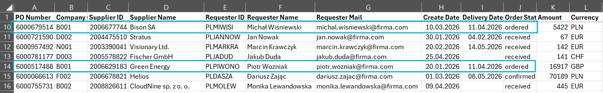
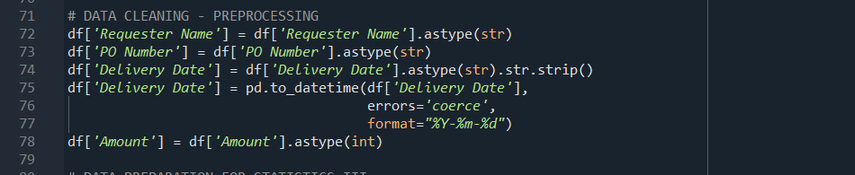
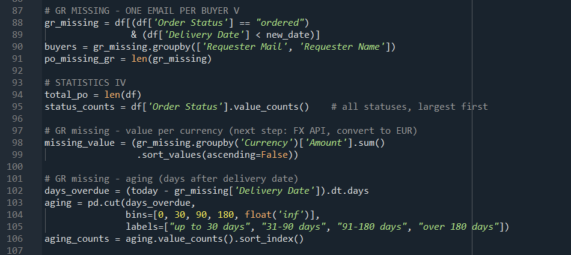
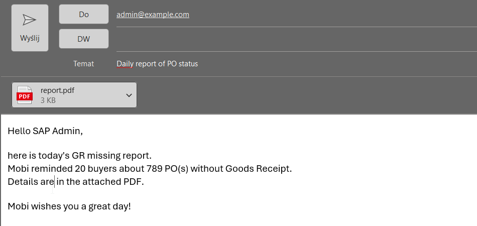
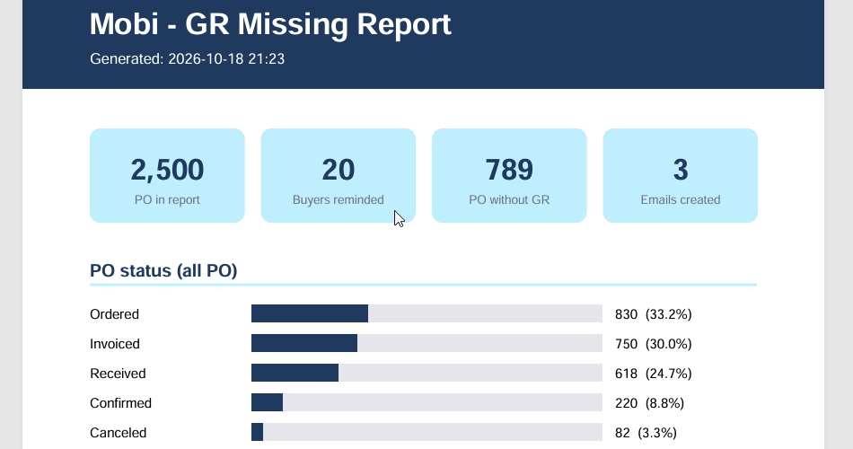
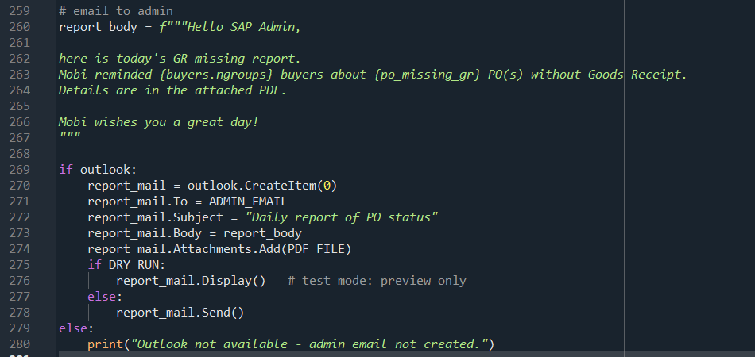

<div style="max-width: 760px;">

# 🪄 Mobi – automation of the “GR missing” process in the PTP/AP area
<hr style="border:1px solid #BFEFFF;">

### Author: Kamila Dudzińska
📊 Project: Mobi – automated email workflow
Mobi is dedicated to operational processes within the Indirect Procurement department.

### 📂 Source: procurement_mock_2500.csv
A mock dataset reflecting the exact technical architecture, data engineering, and business logic of the SAP Ariba system.
The dataset was generated using a Python script I authored — available on my GitHub under the name SAP-Ariba-Mock-Data-Generator-for-Procurement-Analytics. It contains 2500 records.
→ [SAP-Ariba-Mock-Data-Generator-for-Procurement-Analytics](https://github.com/kamila-dudzinska/SAP-Ariba-Mock-Data-Generator-for-Procurement-Analytics)

SAP-Ariba-Mock-Data-Generator-for-Procurement-Analytics — a synthetic SAP Ariba dataset generator for procurement analytics 📊🧪.

A Python tool designed to generate production‑quality synthetic Purchase Order datasets. It mirrors the technical architecture, data engineering, and business logic of SAP Ariba.
This project solves a key problem for procurement experts transitioning into data analytics: the inability to work with real corporate data due to strict compliance rules, NDAs, and GDPR regulations.

### 🎯 Goal
To create a program that analyzes a CSV export table with SAP Ariba purchase order data and automatically sends reminder emails to buyers (requestors) about the need to post a Goods Receipt (GR).
The program also generates an admin report summarizing who received emails and providing PO statistics.
With one click, it saves significant FTE effort and gives administrators a real-time overview of the process.

### ⚙️ Technologies
- Python 🐍  
- pandas, reportlab, win32com  
- Excel (optional for csv reading*), Outlook


### 🧩 How the program works
1. Mobi reads PO data from a CSV export (SAP Ariba mock data).

2. It finds POs in status "ordered" with a delivery date older than 3 days → GR missing.

3. The requestor (buyer) will get --> ONE email with an HTML table of all their POs (PO, supplier, delivery date, amount + currency).

4. The administrator gets a PDF report with statistics.

5. Safe test mode: DRY_RUN = True opens only 3 email previews, nothing is sent.


### 📊 PO Report contains:

* KPI: PO numbers, requestors reminded, PO without GR, emails created
  
* PO status – all statuses

* GR missing – aging (days after delivery date)
  
* GR missing – blocked value per currency
  
* requestors_with_max_missings – top 5 requestors with the highest number of POs without GR


### 🖥️ Project advantages
* Addresses a real operational problem requiring repetitive checking and sending reminders/follow-ups.

* Reduces issues with GR posting among non-technical buyers who often claim: “Guided Buying in Ariba doesn’t allow filtering by status.”

* By monitoring PO and GR status, it helps reduce invoice overdue, minimizing supplier risks and reputation issues.

* Provides administrators with statistics, improving GR process control.

* Automates work within the procurement department.

* Designed for typical corporate environments with logged-in Outlook.

* Dedicated to SAP Ariba, but easily adaptable to other systems — simply analyze reports generated by SAP MM or any other procurement platform.

* Code available in the file mobi.py.

<hr style="border:1px solid #BFEFFF;">


### 🚀 What will be next?

Connect to API: convert blocked value to EUR – overdue invoices and countr the currency risk, not only late payment. Te currency changes in time, sometimes the overdue bills cost more than only dunning letter fee. The report will be showing the new column with information about 'loss' or 'win' basing on actual currency rate.


### ⚙️ Installation & Launch
🔧 Requirements
Python 3.10+

Installed Outlook (for email sending).

Libraries: pandas, reportlab, win32com


### 📦 Installation
```bash
python -m venv .venv
.venv\Scripts\activate
pip install -r requirements.txt
python mobi.py
```

Code snippet: Table with orders


Code snippet: Data Cleaning


Code snippet: Main


Email to administrator preparation mainl:


Email to administrator:


Report - visual metrics:


<hr style="border:3px solid #AEC6CF;">

### Contact:
[](mailto:kamila.dudzinska@onet.pl)
[](mailto:kamila.dudzinska@onet.pl)
[](https://www.linkedin.com/flagship-web/in/kamila-dudzi%C5%84ska-856bb31b8/)

<br></br>

------------------------------------------------ POLISH VERSION -----------------------------------------------------

# 🪄 Mobi - autumatyzacja procesu 'GR missing' w obszarze PTP/AP

<hr style="border:1px solid #BFEFFF;">

### Autor: Kamila Dudzińska

### 📊 Projekt: Mobi – automatyzacja maili z przypomnieniami Mobi jest dedykowany procesom operacyjnym w dziale zakupów (Indirect Procurement).

### 📂 Źródło: Procurement_mock_dataset1 
Mockowy zestaw danych, który odzwierciedla architekturę techniczną, inżynierię danych oraz logikę biznesową systemu SAP Ariba. Zestaw danych został wygenerowany przez skrypt mojego autorstwa – dostępny na moim GitHubie pod nazwą „SAP-Ariba-Mock-Data-Generator-for-Procurement-Analytics”. Zawiera 2500 rekordów. → SAP-Ariba-Mock-Data-Generator-for-Procurement-Analytics

SAP-Ariba-Mock-Data-Generator-for-Procurement-Analytics – generator danych mockowych SAP Ariba dla analityki zakupowej 

Narzędzie w Pythonie do generowania syntetycznych zestawów danych zamówień zakupu (Purchase Orders) produkcyjnej jakości. Odzwierciedla architekturę techniczną, inżynierię danych oraz logikę biznesową SAP Ariba. Projekt rozwiązuje kluczowy problem ekspertów ds. zakupów, którzy chcą przejść do analizy danych: brak możliwości pracy na realnych danych firmowych ze względu na zasady compliance, umowy NDA oraz RODO.


### 🎯Cel: 
Stworzenie programu, który analizuje eksport CSV z danymi o zamówieniach z SAP Ariba i automatycznie wysyła do kupców (requestorów) przypomnienia o konieczności zaksięgowania przyjęcia (GR). Program generuje też raport dla administratora: do kogo poszły maile i jakie są statystyki zamówień. Jednym kliknięciem oszczędza sporo FTE, a administrator od razu widzi realny „stan rzeczy”.


### ⚙️ Technologie:
- Python 🐍  
- pandas, reportlab, win32com  
- Excel (opcjonalnie do odczytu csv*), Outlook


### 🧩 Jak działa program

1. Mobi czyta dane o zamówieniach z eksportu CSV (dane mockowe SAP Ariba).

2. Wyszukuje PO w statusie „ordered” (zamówione), których data dostawy minęła ponad 3 dni temu → brak GR.

3. Każdy requestor (kupiec) dostaje JEDEN mail z tabelką wszystkich swoich PO (numer PO, dostawca, data dostawy, kwota + waluta).

4. Administrator dostaje raport PDF ze statystykami.

5. Bezpieczny tryb testowy: DRY_RUN = True otwiera tylko 3 podglądy maili, nic nie zostaje wysłane.


### 📊 Raport PO zawiera:

* KPI: liczba PO, przypomniani requestorzy, PO bez GR, utworzone maile

* Status PO – wszystkie statusy

* Brak GR – wiek zaległości (dni od daty dostawy)

* Brak GR – zablokowana wartość w podziale na waluty

* requestors_with_max_missings – 5 requestorów z największą liczbą PO bez GR


### 🖥️ Zalety projektu:

*Odpowiada na realny problem operacyjny, w którym trzeba ciągle sprawdzać zamówienia i wysyłać przypominajki/follow-upy.

* Zmniejsza problem z księgowaniem GR przez nietechnicznych kupców, którzy często tłumaczą się: „W Aribie Guided Buying nie da się filtrować po statusach”.

* Dzięki monitorowaniu statusów PO i GR pomaga zmniejszyć „invoice overdue” (faktury płacone po terminie), a co za tym idzie – ryzyko kłopotów z dostawcami i utraty wizerunku.

* Administrator dostaje statystyki, dzięki czemu łatwiej kontroluje proces GR.

* Automatyzuje pracę w dziale zakupów.

* Napisany pod typowe środowisko korporacyjne z zalogowanym Outlookiem.

* Dedykowany SAP Ariba (pracuję na tym systemie jako key user), ale łatwo go dopasować do innych systemów – wystarczy przeanalizować raporty z SAP MM lub dowolnej innej platformy zakupowej.

* Kod dostępny w pliku mobi.py.

<hr style="border:1px solid #BFEFFF;">

###🚀 Co dalej?
Połączenie z API kursów walut: przeliczenie zablokowanej wartości na EUR. Faktury po terminie to nie tylko opóźniona płatność, ale też ryzyko walutowe – kurs zmienia się w czasie i czasem zaległy rachunek kosztuje więcej niż sama opłata za monit. Raport pokaże nową kolumnę z informacją o „stracie” lub „zysku” na podstawie aktualnego kursu.

### ⚙️ Instalacja i uruchomienie
#### 🔧 Wymagania
- Python 3.10+  
- Zainstalowany Outlook (dla wysyłki maili) oraz opcjonalnie Excel do odczytu csv
- Biblioteki: `pandas`, `reportlab`, `win32com`


#### 📦 Instalacja
W katalogu projektu uruchom:
```python -m venv .venv
   .venv\Scripts\activate
    pip install -r requirements.txt
    python mobi.py
```

#### Tabela z zamówieniami (na niebiesko te zamówienia, gdzie Mobi powienien wysłać przypominajkę):


#### Fragment kodu: Czyszczenie danych


#### Fragment kodu: Main 


#### Email do administratora - kod:


#### Email do administratora


#### Raport - wizualizacja:


<hr style="border:3px solid #AEC6CF;">


### Kontakt:  

[](mailto:kamila.dudzinska@onet.pl)
[](mailto:kamila.dudzinska@onet.pl)
[](https://www.linkedin.com/flagship-web/in/kamila-dudzi%C5%84ska-856bb31b8/)


